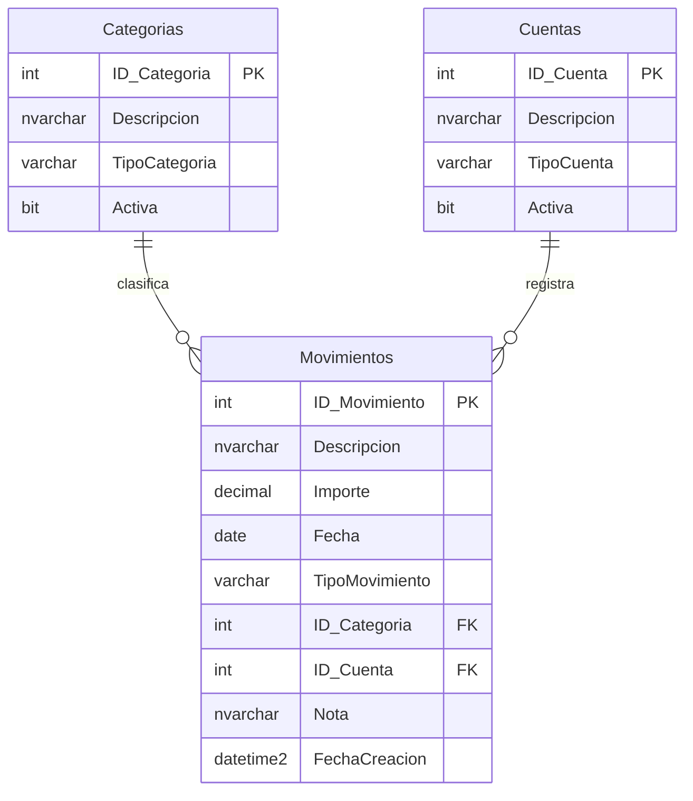

# Diseño de base de datos — versión 1

## Objetivo

La primera versión de la base de datos persistirá las funciones que actualmente existen
en el frontend: movimientos, categorías y cuentas. Los totales y saldos se calcularán a
partir de los movimientos y no se almacenarán como columnas.

## Convenciones de nombres

- Los nombres de tablas se escriben en plural: `Categorias`, `Cuentas`, `Movimientos`.
- Las claves se nombran `ID_` seguido de la tabla en singular: `ID_Categoria`.
- Las claves foráneas conservan el nombre de la clave que referencian.
- Los campos de tipo incluyen la entidad singular: `TipoMovimiento`.
- Los identificadores SQL no utilizan `ñ`, tildes ni otros caracteres especiales.
- Los campos compuestos usan PascalCase: `FechaCreacion`.
- `Descripcion` acompaña al identificador principal de las entidades.

## Diagrama relacional



Una categoría puede clasificar muchos movimientos. Una cuenta puede contener muchos
movimientos. Cada movimiento requiere exactamente una categoría y una cuenta.

## Tabla `Categorias`

| Columna | Tipo SQL | Nulo | Regla |
|---|---|---:|---|
| `ID_Categoria` | `int IDENTITY(1,1)` | No | Clave primaria. |
| `Descripcion` | `nvarchar(100)` | No | Nombre visible de la categoría. |
| `TipoCategoria` | `varchar(10)` | No | `Ingreso` o `Gasto`. |
| `Activa` | `bit` | No | Valor inicial `1`. |

Restricciones previstas:

- `PK_Categorias` sobre `ID_Categoria`.
- `UQ_Categorias_Descripcion_TipoCategoria` sobre `Descripcion` y `TipoCategoria`.
- `CK_Categorias_TipoCategoria` limita los valores a `Ingreso` y `Gasto`.
- `DF_Categorias_Activa` establece `1` como valor inicial.

## Tabla `Cuentas`

| Columna | Tipo SQL | Nulo | Regla |
|---|---|---:|---|
| `ID_Cuenta` | `int IDENTITY(1,1)` | No | Clave primaria. |
| `Descripcion` | `nvarchar(100)` | No | Nombre visible de la cuenta. |
| `TipoCuenta` | `varchar(20)` | No | Tipo admitido de cuenta. |
| `Activa` | `bit` | No | Valor inicial `1`. |

Valores iniciales de `TipoCuenta`:

- `Efectivo`.
- `CuentaBancaria`.
- `BilleteraVirtual`.

Restricciones previstas:

- `PK_Cuentas` sobre `ID_Cuenta`.
- `UQ_Cuentas_Descripcion` evita nombres repetidos.
- `CK_Cuentas_TipoCuenta` limita los tipos admitidos.
- `DF_Cuentas_Activa` establece `1` como valor inicial.

No existe una columna de saldo. Todas las cuentas comienzan contablemente en cero y el
dinero anterior se registra como un movimiento de ingreso con descripción `Saldo inicial`.

## Tabla `Movimientos`

| Columna | Tipo SQL | Nulo | Regla |
|---|---|---:|---|
| `ID_Movimiento` | `int IDENTITY(1,1)` | No | Clave primaria. |
| `Descripcion` | `nvarchar(200)` | No | Motivo del movimiento. |
| `Importe` | `decimal(18,2)` | No | Debe ser mayor que cero. |
| `Fecha` | `date` | No | Fecha financiera del movimiento. |
| `TipoMovimiento` | `varchar(10)` | No | `Ingreso` o `Gasto`. |
| `ID_Categoria` | `int` | No | Clave foránea a `Categorias`. |
| `ID_Cuenta` | `int` | No | Clave foránea a `Cuentas`. |
| `Nota` | `nvarchar(500)` | Sí | Información adicional opcional. |
| `FechaCreacion` | `datetime2(0)` | No | Fecha técnica de creación. |

Restricciones previstas:

- `PK_Movimientos` sobre `ID_Movimiento`.
- `CK_Movimientos_Importe` exige `Importe > 0`.
- `CK_Movimientos_TipoMovimiento` limita los valores a `Ingreso` y `Gasto`.
- `FK_Movimientos_Categorias` relaciona `ID_Categoria`.
- `FK_Movimientos_Cuentas` relaciona `ID_Cuenta`.
- `DF_Movimientos_FechaCreacion` utiliza `SYSDATETIME()`.
- Las claves foráneas no eliminan movimientos en cascada.

## Índices iniciales

- `IX_Movimientos_Fecha` para consultas por período.
- `IX_Movimientos_ID_Categoria` para filtros y relaciones.
- `IX_Movimientos_ID_Cuenta` para movimientos y saldos por cuenta.
- `IX_Movimientos_TipoMovimiento_Fecha` para totales por tipo y período.

Los índices se revisarán con consultas reales; no se agregarán índices especulativos fuera
de estas necesidades visibles del frontend.

## Reglas que requieren backend

SQL Server protege tipos, importes y relaciones. El backend deberá verificar reglas que
dependen de más de una tabla:

- `TipoMovimiento` debe coincidir con `TipoCategoria`.
- Una categoría o cuenta inactiva no se utiliza en movimientos nuevos.
- Una categoría o cuenta relacionada no se elimina físicamente; se desactiva.
- Las descripciones no pueden estar vacías ni contener solamente espacios.

La primera versión no utilizará triggers para estas reglas. Se implementarán en el backend
y se verificarán mediante pruebas.

## Cálculos derivados

```text
Total de ingresos = suma de Importe donde TipoMovimiento = Ingreso
Total de gastos   = suma de Importe donde TipoMovimiento = Gasto
Balance           = total de ingresos - total de gastos
Saldo de cuenta   = ingresos de la cuenta - gastos de la cuenta
```

No se almacenan `Saldo`, `SaldoActual`, `SaldoInicial`, `TotalIngresos`, `TotalGastos` ni
`Balance`. Esto evita que un movimiento modificado deje valores derivados inconsistentes.

## Ejemplos

Movimiento válido:

```text
Descripcion: Supermercado
Importe: 25000.00
Fecha: 2026-08-15
TipoMovimiento: Gasto
ID_Categoria: categoría activa de tipo Gasto
ID_Cuenta: cuenta activa
```

Casos inválidos:

- `Importe` igual a cero o negativo.
- `TipoMovimiento` distinto de `Ingreso` o `Gasto`.
- Categoría o cuenta inexistente.
- Movimiento de ingreso asociado a una categoría de gasto.
- Descripción vacía.

## Fuera del alcance de la versión 1

- Usuarios y propiedad de datos.
- Presupuestos.
- Transferencias.
- Movimientos recurrentes.
- Tarjetas de crédito.
- Múltiples monedas.
- Auditoría avanzada.
