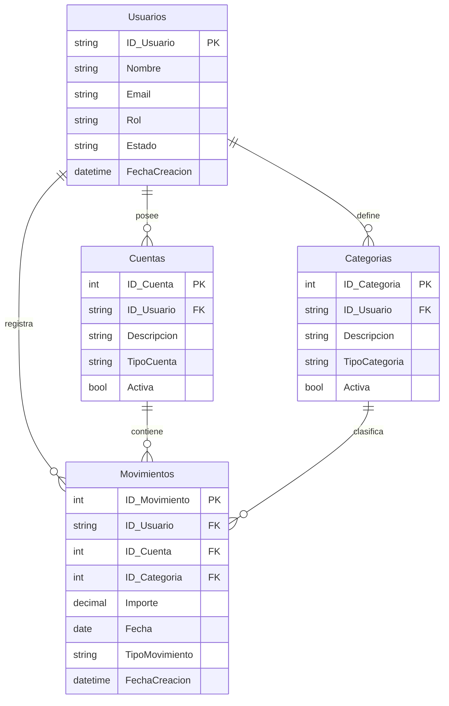

# Visión y potencial de Finanzas Personales

## Propósito

Finanzas Personales puede evolucionar desde un registro individual de ingresos y gastos
hacia una plataforma multiusuario para comprender, ordenar y planificar la economía
personal. Su valor no estaría solamente en guardar movimientos, sino en convertir esos
datos en información útil para tomar decisiones.

La evolución debe conservar una idea central: cada función nueva tiene que resolver una
necesidad financiera concreta sin perder simplicidad, trazabilidad ni aislamiento entre
usuarios.

## Visión de producto

Una persona debería poder entrar a la aplicación y responder con claridad:

- cuánto dinero tiene y en qué cuentas;
- cuánto ingresó y gastó durante un período;
- en qué categorías se concentra su gasto;
- qué compromisos futuros tiene;
- si está cumpliendo sus presupuestos y objetivos;
- qué cambió respecto de meses anteriores.

A futuro, la misma base podría servir tanto para una persona como para un hogar que
administra finanzas compartidas, sin convertirse en un sistema contable empresarial.

## Usuarios y roles iniciales

Se proponen dos roles de aplicación. El rol expresa qué puede hacer una persona; no
reemplaza la propiedad de cada dato.

### Usuario

Es quien utiliza las funciones financieras. Puede:

- registrarse e iniciar y cerrar sesión;
- administrar su perfil y cambiar su contraseña;
- crear y administrar sus cuentas, categorías y movimientos;
- consultar únicamente los datos a los que tiene acceso;
- ver resúmenes, filtros e informes propios;
- exportar sus datos o solicitar la eliminación de su cuenta en una etapa posterior.

### Administrador

Administra la plataforma, no las finanzas cotidianas de los usuarios. Puede:

- consultar usuarios, estados y fechas técnicas de actividad;
- activar, bloquear o desbloquear una cuenta de acceso;
- administrar catálogos globales o parámetros del sistema;
- consultar métricas técnicas y registros de auditoría;
- atender incidencias sin conocer contraseñas ni operar movimientos como si fuera el
  usuario.

El administrador no debería ver información financiera privada por defecto. Si en el
futuro se habilita soporte con acceso excepcional, deberá quedar limitado, justificado y
auditado.

## Autenticación, autorización y propiedad

Son tres responsabilidades diferentes:

- **Autenticación:** demostrar quién es la persona mediante registro e inicio de sesión.
- **Autorización:** decidir qué acciones permite su rol.
- **Propiedad:** determinar a qué información concreta puede acceder.

No alcanza con proteger un endpoint con inicio de sesión. Todas las consultas y
modificaciones financieras deben limitarse por el usuario o espacio financiero al que
pertenece el dato. Un identificador válido nunca debe permitir acceder a información de
otra persona.

Para el aprendizaje inicial se puede implementar autenticación propia con ASP.NET Core
Identity y tokens. Antes de publicar el sistema se deberá decidir conscientemente entre
tokens y cookies seguras según el despliegue final. Las contraseñas nunca se almacenan en
texto plano; se delegan al mecanismo probado de hashing de Identity.

## Modelo relacional propuesto

### Primera evolución: propiedad individual

La ampliación mínima agrega usuarios y hace que los recursos financieros tengan dueño.



Incluir `ID_Usuario` directamente en movimientos facilita el aislamiento y las consultas,
aunque el usuario también pueda deducirse desde la cuenta. Esa duplicación controlada
exige validar que usuario, cuenta, categoría y movimiento pertenezcan al mismo dueño.

Las reglas de unicidad actuales también deben pasar a ser por usuario. Por ejemplo, dos
personas pueden tener una cuenta llamada `Efectivo`, pero una misma persona no debería
repetirla accidentalmente.

### Evolución posterior: espacios compartidos

Si se quieren finanzas familiares, conviene evitar agregar varios dueños directamente a
cada movimiento. El concepto más flexible es un `EspacioFinanciero`:

```text
Usuario -> MiembroEspacio -> EspacioFinanciero
                              |-> Cuentas
                              |-> Categorias
                              `-> Movimientos
```

Un espacio puede ser personal o compartido. `MiembroEspacio` permite asignar permisos
como propietario, editor o lector. Este modelo abre la puerta a parejas y hogares sin
confundir esos permisos con el rol global de administrador de la plataforma.

No se recomienda incorporar esta estructura en la primera entrega multiusuario. Sí
conviene conservarla como dirección de diseño para evitar que “usuario” y “hogar” queden
mezclados conceptualmente.

## Registros y trazabilidad

La palabra registro abarca necesidades distintas y conviene separarlas:

1. **Registros financieros:** movimientos de ingreso, gasto y, más adelante,
   transferencias.
2. **Fechas de auditoría:** creación y última modificación de cada entidad, junto con el
   usuario que realizó la acción.
3. **Historial de cambios:** qué valor cambió, cuándo y quién lo cambió; útil cuando hay
   espacios compartidos.
4. **Logs técnicos:** errores, peticiones relevantes y eventos de seguridad para operar la
   aplicación. No deben guardar contraseñas, tokens ni información financiera innecesaria.
5. **Eventos de acceso:** registro, inicio de sesión exitoso o fallido, cambio de contraseña,
   bloqueo y cierre de sesiones.

Para una primera versión alcanza con fechas de creación y modificación, identificador del
actor y logs estructurados de seguridad. El historial detallado puede agregarse cuando
existan edición compartida o requisitos reales de auditoría.

## Capacidades con potencial

### Núcleo financiero

- transferencias entre cuentas como una operación única con dos efectos relacionados;
- movimientos recurrentes y recordatorios;
- presupuestos mensuales por categoría;
- metas de ahorro y seguimiento de progreso;
- cuotas, tarjetas de crédito y fechas de vencimiento;
- múltiples monedas con una moneda base claramente definida;
- adjuntos o comprobantes;
- importación y exportación CSV.

### Inteligencia y análisis

- comparación entre períodos;
- evolución del patrimonio y flujo de caja;
- detección de gastos inusuales;
- proyecciones basadas en compromisos y recurrencias;
- alertas configurables;
- recomendaciones explicables basadas en los propios datos.

Estas funciones deben mostrar cómo se obtuvo cada resultado. Una recomendación financiera
no debería presentarse como asesoramiento profesional ni ocultar sus supuestos.

### Producto y operación

- panel administrativo limitado y auditable;
- recuperación y verificación de cuenta;
- preferencias regionales, moneda y zona horaria;
- accesibilidad y diseño adaptable a móviles;
- copias de seguridad y restauración;
- observabilidad, métricas técnicas y manejo uniforme de errores;
- despliegue automatizado y ambientes separados.

## Límites recomendados

En el corto plazo, el proyecto no debería intentar:

- conectarse directamente a bancos o ejecutar pagos;
- almacenar números completos de tarjetas o credenciales bancarias;
- ofrecer recomendaciones de inversión personalizadas;
- incorporar múltiples monedas antes de resolver transferencias y cierres por período;
- construir colaboración familiar antes de garantizar el aislamiento individual.

Estos límites reducen riesgos y mantienen el valor educativo del proyecto.

## Hoja de ruta propuesta

### Etapa 1 — Preparar el núcleo existente

- corregir documentación desactualizada y consolidar el estado real;
- agregar pruebas para las reglas actuales;
- uniformar validaciones y respuestas de error;
- definir migraciones y datos de desarrollo reproducibles.

**Resultado:** el CRUD actual es una base estable sobre la cual migrar datos.

### Etapa 2 — Identidad y sesión

- incorporar ASP.NET Core Identity;
- implementar registro, inicio y cierre de sesión;
- definir los roles `Usuario` y `Administrador`;
- proteger rutas del backend y del frontend;
- agregar recuperación de contraseña cuando exista un servicio de correo.

**Resultado:** cada petición protegida tiene una identidad verificable.

### Etapa 3 — Aislamiento multiusuario

- agregar propiedad a cuentas, categorías y movimientos;
- migrar o asignar los datos existentes a un usuario inicial;
- filtrar todas las consultas por propietario;
- validar propiedad en altas, cambios y eliminaciones;
- probar explícitamente que un usuario no accede a identificadores ajenos.

**Resultado:** dos usuarios pueden utilizar la aplicación sin compartir datos.

### Etapa 4 — Administración y auditoría mínima

- crear gestión de estado de usuarios;
- incorporar fechas y actor de creación/modificación;
- registrar eventos de acceso y acciones administrativas;
- aplicar minimización de datos en el panel administrador.

**Resultado:** la plataforma puede operarse y las acciones sensibles son trazables.

### Etapa 5 — Funciones financieras de mayor valor

- transferencias entre cuentas;
- movimientos recurrentes;
- presupuestos y metas de ahorro;
- informes comparativos y exportación.

**Resultado:** la aplicación ayuda a planificar, además de registrar.

### Etapa 6 — Colaboración opcional

- modelar espacios financieros y miembros;
- definir permisos de propietario, editor y lector;
- migrar la propiedad individual al espacio personal de cada usuario;
- agregar historial suficiente para acciones compartidas.

**Resultado:** una persona puede invitar a otra sin perder control ni trazabilidad.

## Primera versión multiusuario sugerida

La entrega debe mantenerse pequeña y comprobable:

- registro e inicio de sesión;
- roles Usuario y Administrador;
- cuentas, categorías y movimientos privados por usuario;
- panel administrativo para listar y bloquear usuarios, sin exponer sus finanzas;
- fechas de creación y modificación;
- pruebas de autorización y aislamiento;
- sin hogares compartidos, pagos, bancos ni funciones avanzadas.

## Criterios de éxito

- una persona nueva completa el registro y crea su primer movimiento sin asistencia;
- ningún recurso financiero puede consultarse o modificarse desde otra identidad;
- los saldos y totales continúan derivándose de movimientos consistentes;
- una acción administrativa sensible queda registrada;
- el modelo admite después un espacio compartido sin rediseñar el núcleo financiero;
- cada etapa conserva compilación, pruebas y documentación verificables.

## Decisiones pendientes

Antes de implementar se deberán resolver y documentar estas preguntas:

- ¿la aplicación será solamente educativa/local o se publicará para usuarios reales?
- ¿el segundo tipo de usuario será efectivamente un administrador de plataforma?
- ¿se desea en el futuro compartir finanzas con pareja o familia?
- ¿el acceso web usará cookies seguras o tokens según la arquitectura de despliegue?
- ¿qué datos puede consultar soporte y bajo qué autorización?
- ¿qué política de conservación, exportación y eliminación de datos se ofrecerá?
- ¿qué moneda y zona horaria son la referencia inicial?

Estas decisiones cambian el diseño y deben tomarse antes de modificar el esquema SQL.
